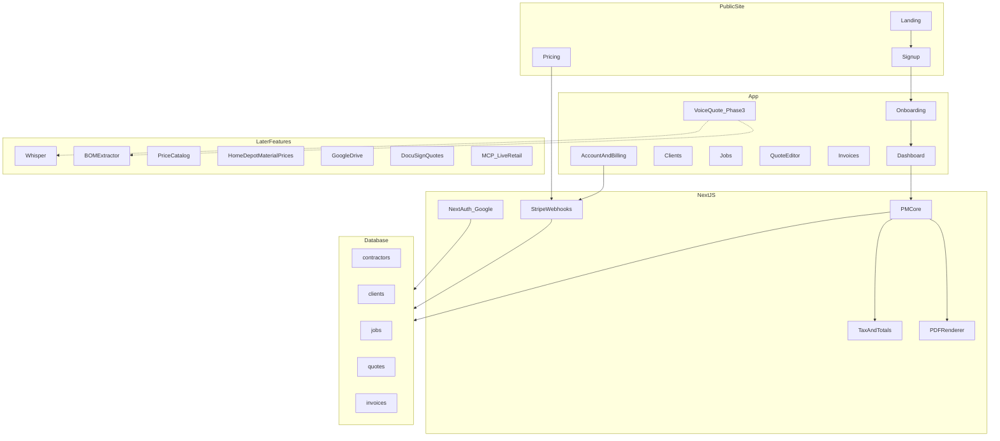
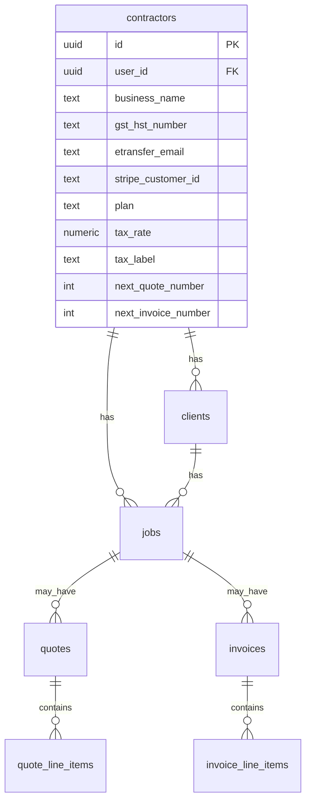
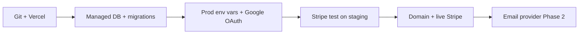

# Trades Project Planner — Scoping Plan

Phased scope for a small-scale SaaS PM platform for solo Canadian tradespeople. Phase 1 ships the PM hub plus the bare-minimum SaaS shell (landing, pricing, live Stripe, polished onboarding). Voice-to-quote and smart pricing remain later features inside that hub.

## Task tracker

### Features
- [ ] **Phase 1:** PM hub + SaaS shell (landing, pricing, Stripe, onboarding, auth emails, GST/HST PDFs)
- [ ] **Phase 2:** Quote → job workflow, shopping list, invoice-from-job, shareable client links
- [ ] **Phase 3:** Voice/text → AI quote draft with human review inside quote creation
- [ ] **Phase 4:** Growth leftovers — payment reminders, client payment links, marketing polish
- [ ] **Phase 5:** Contractor price catalog (simple) then optional live retail via MCP
- [ ] **Phase 6:** PWA for on-site use (voice capture once Phase 3 is live)
- [ ] **Later:** Link Google Drive — save PDFs/photos per client/job
- [ ] **Later:** Home Depot pricing from the material / shopping list
- [ ] **Later:** Auto-create DocuSign envelopes from quotes
- [ ] **Idea:** Template-based estimates for common job types
- [ ] **Idea:** Tiered proposals (good / better / best)

### Engineering
- [x] **Production:** Deploy app on Vercel ([trades-planner-bay.vercel.app](https://trades-planner-bay.vercel.app))
- [x] **Production:** Supabase Postgres + `DATABASE_URL` on Vercel (app login/CRUD)
- [x] **Production:** Google OAuth prod redirect + `AUTH_*` env vars on Vercel
- [ ] **Production:** Stripe live mode — Checkout, webhooks, Customer Portal, plan gating
- [ ] **Production:** Custom domain (optional)

**Target user:** Solo trades contractor in Canada (plumber, electrician, carpenter, general contractor) who is strong on the job site and weak on admin — quotes, invoices, GST/HST, client follow-up.

**Positioning:** Lean admin hub that is easier than Jobber/Housecall Pro. One login per business. Canada first (GST/HST, business number on documents). Web-first; mobile later from the same codebase.

---

## Features

Things the app should do for contractors — product capabilities, phased roadmap, and ideas not yet scheduled.

### Core value (MVP)

1. One place for clients, jobs, quotes, and invoices instead of texts + spreadsheets + Word docs
2. Simple lifecycle: quote → approved job → invoice → paid
3. Professional PDFs with Canadian invoice fields (business number, GST/HST) with almost no setup

**Differentiator (later, inside quote creation):** voice/text → pre-filled quote draft; smart material pricing (contractor catalog first; live retail later).

### What’s in scope vs out of scope

**Phase 1 (product + SaaS shell):**
- Public landing page + pricing
- Sign up / sign in (Google today; auth emails when we add email/password)
- Onboarding: business identity, tax, rates, e-transfer payment instructions
- Live Stripe: one Pro plan (trial OK), webhook → account access
- Account/settings (profile, billing portal, logout)
- Clients, jobs, manual quotes/invoices, dashboard
- GST/HST PDFs, sequential numbering

**Phase 2 adds the job loop:** share links, client approve, shopping list, email-to-client.

**Explicitly out of Phase 1–2:**
- Crew / extra logins
- Dispatch, calendar, time tracking, GPS
- Accounting sync
- Deposits, progress invoices, formal change orders
- Voice/AI, live retail pricing, Home Depot lookups
- Google Drive, DocuSign, estimate templates, tiered proposals
- Payment reminder campaigns, ads, content marketing

### Phase roadmap

#### Phase 1 — PM core + SaaS shell (7–8 weeks)
**Goal:** A stranger can land, subscribe, set up the business, and run paperwork (PDF download).

**Public**
- Landing: what it is, who it’s for, 3-step “quote → job → invoice”
- Pricing: one Pro plan + trial copy, CTA to Stripe Checkout
- Footer legal stubs (privacy / terms)

**Auth & billing (product surface)**
- Stripe Checkout (one product), Customer Portal for cancel/update card
- Account page: “Manage billing”

**Onboarding**
1. Business name, logo, address, phone, email
2. BN / GST-HST number, tax rate + label
3. Default labour rate, default markup
4. How clients pay you (e-transfer email + optional note)
5. Confirm → Stripe if not already subscribed → dashboard

**PM hub**
- Clients, jobs, quote editor, invoice editor, dashboard
- Sequential numbering, GST/HST PDFs
- Settings can edit everything onboarding captured

**Phase 1 “send quote” = download PDF.** You email it yourself.

**Success criteria:** Landing → pricing → pay/trial → onboarding → add client → quote PDF with HST and e-transfer line → invoice → mark paid. Billing portal works.

---

#### Phase 2 — Lifecycle (2–3 weeks)
**Goal:** Objects connect; *your client* can open a quote without an account.

- Approve quote → job `active`; copy line items
- Decline with optional reason
- Shopping list (material lines, check-off)
- Invoice from job
- Shareable quote/invoice links + Approve / Decline
- Resend: email the *job client* a link (not marketing)
- Job activity log

**Success criteria:** Quote link → client approves → shopping list → invoice sent → paid.

---

#### Phase 3 — Voice / AI quote feature (3–4 weeks)
**Goal:** “Describe the job” inside the existing quote editor.

- Text or audio → Whisper → editable transcript
- LLM → line items into the same editor; never auto-send
- Plumbing-first prompt
- Store transcript on the quote

---

#### Phase 4 — Growth leftovers (1–2 weeks)
- Payment reminder emails (overdue invoices)
- Optional Stripe Payment Link for *job clients* (cards); e-transfer stays default
- Landing copy refresh once voice exists
- Usage-based limits if you want a Free vs Pro split

---

#### Phase 5 — Smart pricing (3–5 weeks)
**5a:** contractor catalog + last-quoted-price (table, not MCP).  
**5b:** Home Depot pricing from the **material list / shopping list** — look up a line, attach a product/SKU (Canada stores), refresh unit price, keep the contractor’s markup.

---

#### Phase 6 — Mobile / field (3–5 weeks)
PWA first. Expo only if PWA mic/offline is not enough.

---

### Ideas backlog

Product ideas captured from discussion. **Not scheduled** — do not pull into Phase 1–2 without an explicit phase decision.

#### Integrations

**Link Google Drive**
- Auto-save quote and invoice PDFs into a folder per client / job
- Optional: job photos and signed docs in the same folder
- Optional: attach existing Drive files onto a job
- Fits after Phase 2 and Google sign-in (already the only login)

**DocuSign for quotes**
- Auto-create a DocuSign envelope from the quote — client signs **that document**
- Track sent / viewed / signed / declined
- On complete: mark quote approved, store signed PDF (and in Drive if linked)
- Replaces or sits beside Phase 2 shareable Approve/Decline links

#### Pricing & materials

**Home Depot pricing from the material list**
- Search / link a product from the line description
- Pull current unit price (Canadian store if possible), keep markup + tax
- Show last refreshed time; never overwrite a locked/sent quote without asking
- Same as Phase 5b — Home Depot as first supplier

#### Quoting & proposals

**Template-based estimates**
- Reusable templates: name, default line items, notes, typical quantities
- Examples: “Bathroom rough-in”, “Panel upgrade”, “Kitchen backsplash”
- Start a new quote from a template → pre-filled lines, editable before send
- Pairs well with voice-to-quote (Phase 3)

**Tiered proposals (good / better / best)**
- One quote with three material tiers; client picks a level
- Each tier: line items, subtotal, tax, total — side-by-side or tabs on PDF / client link
- Approved tier becomes job scope and drives shopping list + invoice
- Likely Phase 2+ after basic approve/decline works

---

### Feature timeline

Assumes **1 full-stack developer**:

| Phase | Focus | Duration | Cumulative |
|-------|-------|----------|------------|
| 1 | PM hub + landing/pricing/Stripe/onboarding | 7–8 wks | 8 wks |
| 2 | Lifecycle + share links + client email | 2–3 wks | 11 wks |
| 3 | Voice/AI quote feature | 3–4 wks | 15 wks |
| 4 | Reminders / payment-link extras | 1–2 wks | 17 wks |
| 5 | Catalog, then optional live pricing | 3–5 wks | 22 wks |
| 6 | PWA | 3–5 wks | 27 wks |

**Subscribe-able product with PDFs:** end of Phase 1  
**Beta with client-facing quotes:** end of Phase 2  
**Differentiator (voice):** end of Phase 3  

---

### Open product decisions

- **Plan shape:** one Pro + 14-day trial (recommended) vs Free-with-limits
- **Price point:** pick later; page can ship with a placeholder CAD amount
- **Default tax:** contractor types rate + label (recommended)
- **PWA vs Expo:** PWA
- **First AI trade prompt:** plumbing
- **Quote acceptance:** custom share link vs DocuSign as the default “client signs the quote”
- **Drive:** auto-create folders for every job vs only when the contractor clicks “Save to Drive”
- **Tiered quotes:** three tiers on one quote vs three separate quote documents linked together
- **Templates:** global library vs per-contractor only; whether voice (Phase 3) can spawn from a template

---

## Engineering

How we build, host, and operate the product — stack, data model, and production checklist.

### Recommended stack

| Layer | Recommendation | Why |
|-------|----------------|-----|
| App | **Next.js (App Router) + React + Tailwind** | Marketing site + app in one repo |
| Data access | **Server Actions + Server Components** (not a public REST API yet) | Same deployable; auth + tenant scoping built in |
| HTTP API (when needed) | **Next.js Route Handlers** | Stripe webhooks, public quote links, mobile, integrations |
| Database | **Supabase Postgres** via Drizzle + `DATABASE_URL` | Hosted Postgres; schema applied |
| Auth | **NextAuth + Google OAuth** (not Supabase Auth) | Session cookies; contractor row on sign-in |
| PDF | **@react-pdf/renderer** or print CSS | Quote/invoice PDFs |
| Billing | **Stripe Checkout + Customer Portal + webhooks** | Live in Phase 1 |
| Email (Phase 2) | **Resend** | Quote/invoice links to *clients* |
| AI / Voice (Phase 3+) | Whisper + Claude or GPT-4o | Later |
| Hosting | **Vercel** | Low ops |

**Repo:** one Next.js app (`trades-planner`). Marketing routes (`/`, `/#pricing`) and app routes (`/app/...`) in the same project.

**Local dev + production:** Next.js + Drizzle → **Supabase Postgres** via `DATABASE_URL`. Google sign-in via NextAuth (not Supabase Auth).

---

### Data access architecture (current)

**Status:** Read/write works today for logged-in users. No separate REST API for CRUD — and that is intentional for Phase 1.

```
Browser → Server Actions / Server Components → Drizzle → Supabase Postgres
                ↑
           NextAuth session (contractor_id scoping)
```

| Operation | Where | Notes |
|-----------|--------|--------|
| **Read** | `lib/queries.ts` | Server Components call Drizzle; scoped by `getContractor()` |
| **Write** | `lib/actions/data.ts`, `lib/actions/auth.ts` | Form posts via Server Actions |
| **Auth** | `app/api/auth/[...nextauth]/route.ts` | Only public HTTP API route today |

**Supported now:** clients, jobs, quotes, invoices (create/update), onboarding, settings, invoice-from-quote, PDF print views, dashboard lists. All tenant-scoped by `contractor_id`.

**Do not add a full REST API yet.** Server Actions are the standard Next.js pattern for a logged-in web app; the “backend” runs on the same Vercel deployment as the UI.

**Add Route Handlers when there is a concrete need:**

| Trigger | Example route |
|---------|----------------|
| Stripe webhooks | `POST /api/stripe/webhook` |
| Shareable client links (Phase 2) | `GET /api/quotes/[token]` |
| Mobile app (Phase 6+) | JSON CRUD endpoints |
| Third-party integrations | Zapier, accounting sync, etc. |
| Voice-to-quote service (Phase 3) | External POST of draft line items |

New API routes should reuse `ensureDb()` and the same auth/tenant checks — no Supabase client SDK required for Postgres access.

---

### System architecture



---

### Data model (Phase 1)

Solo Canada: `contractors` is 1:1 with auth user. Every table has `contractor_id` and RLS (when on Postgres).

Billing fields on `contractors`: `stripe_customer_id`, `stripe_subscription_id`, `plan` (`trial` / `pro` / `past_due` / `canceled`), `onboarding_completed_at`.

Also store **client-facing payment instructions** (e-transfer email, optional memo) so invoices can print “Pay by Interac e-Transfer to …”



**Line item `kind`:** `material` | `labour` | `other`.

**Tax:** single rate + label (contractor enters on onboarding; default suggestion 13% HST).

**Numbers:** `Q-0001` / `INV-0001` per contractor.

**Quotes without a job:** allowed; approving later creates the job.

**Gating:** unfinished onboarding → `/onboarding`. No active/trial subscription → billing wall (recommended flow: **onboard → Checkout → app**).

---

### Production infrastructure

Checklist for going from **local dev** to a **hosted SaaS**. Order matters — hosting + database + secrets before flipping Stripe to live.

#### 1. Hosting & deploy
- [x] **Git remote** — [github.com/lucasrea/trades-planner](https://github.com/lucasrea/trades-planner)
- [x] **Vercel project** — auto-deploy from `master`, `npm run build`, Node 20+
- [ ] **Custom domain** — e.g. `app.tradesplanner.ca`; DNS → Vercel; SSL automatic
- [x] **Preview vs production** — preview deploys per PR; production branch = `master`
- [x] **Environment variables** on Vercel (never commit): `AUTH_SECRET`, `AUTH_URL`, `AUTH_GOOGLE_*`, `DATABASE_URL`
- [ ] Stripe keys, email API key (when those features ship)

#### 2. Database (Supabase Postgres)
Local SQLite does not survive serverless/multi-instance deploys. **Chosen path: Supabase Postgres** via Drizzle + `postgres` driver.

**Steps:**
- [x] Provision Supabase project (`tradesplanner`)
- [x] App reads `DATABASE_URL` (transaction pooler, port 6543) — see `lib/db/index.ts`
- [x] Add `DATABASE_URL` to Vercel env vars (production + preview) and redeploy
- [x] Apply schema — `supabase/migrations/20250824200000_initial.sql` (SQL editor or `./scripts/db-push.sh`)
- [ ] **Smoke-test prod:** sign in → onboarding → client → quote → PDF
- [ ] Enable **automated backups** in Supabase (daily minimum; test a restore once)
- [x] Connection pooling — Supabase transaction pooler for serverless/Vercel

#### 3. Payments (Stripe — contractor subscriptions)

Two payment layers — don’t confuse them:

| Who pays | What | When |
|----------|------|------|
| **Contractor → you** | Pro subscription (SaaS) | Production launch / end of trial |
| **Client → contractor** | Invoice (e-transfer today; card link later) | Phase 2+ |

**Stripe SaaS billing checklist:**
- [ ] Stripe account verified (Canadian business or sole prop)
- [ ] **Live mode** product + price (CAD, monthly Pro; optional annual)
- [ ] **Checkout** from pricing — success/cancel URLs on production domain
- [ ] **Customer Portal** — “Manage billing” in settings
- [ ] **Webhooks** — `checkout.session.completed`, `customer.subscription.updated/deleted`, `invoice.payment_failed` → update `contractors.plan`
- [ ] Webhook endpoint: `https://yourdomain.com/api/stripe/webhook`
- [ ] Remove “every account is Pro” dev stub; gate `/app` on active subscription or trial
- [ ] Test with Stripe test mode on staging before live keys

**Later (Phase 4):** Stripe Payment Links on *invoices* for job clients — separate from SaaS subscription.

#### 4. Auth (Google OAuth in production)
- [x] OAuth redirect: `https://trades-planner-bay.vercel.app/api/auth/callback/google`
- [ ] **Publish OAuth consent screen** (or Testing + test users for private beta)
- [x] `AUTH_SECRET` on Vercel production + preview
- [x] `AUTH_URL` on Vercel production (Vercel URL until custom domain)
- [ ] Confirm session cookies work on custom domain (when added)

#### 5. Email (Phase 2+, infra-ready early)
- [ ] **Resend** (or Postmark / SendGrid) — domain verification, SPF/DKIM
- [ ] Transactional templates: quote sent, invoice sent, payment reminder
- [ ] `FROM` address e.g. `quotes@yourdomain.com`

#### 6. Files & PDFs
- [ ] Today: PDFs generated on the fly — fine for v1
- [ ] Later: **object storage** (Supabase Storage, R2, S3) for signed quotes, photos, DocuSign PDFs

#### 7. Observability & ops
- [ ] **Error tracking** — Sentry (or Vercel logs + alerts)
- [ ] **Uptime check** on `/` and `/api/auth/providers`
- [ ] Structured logging for Stripe webhooks and auth failures
- [ ] **Cron** (Vercel Cron or Inngest) for overdue-invoice reminders — Phase 4

#### 8. Security & compliance (Canada)
- [ ] Privacy policy + Terms on production domain (PIPEDA-aware)
- [ ] Secrets only in host env; rotate if leaked
- [ ] Rate-limit auth and public quote links if abused
- [ ] Data export / delete path for contractor accounts

#### 9. Suggested deploy order



1. Deploy to Vercel with **empty prod DB**
2. Migrate schema; smoke-test signup → onboarding → CRUD
3. Wire Stripe **test mode** on staging preview URL
4. Custom domain + Google prod OAuth + **Stripe live**
5. Resend when client-facing quote links ship

#### 10. Cost ballpark (solo scale)
- Vercel: free → ~$20/mo Pro if needed
- Supabase / Turso / Neon: free tier → ~$25/mo as you grow
- Stripe: per-transaction only
- Resend: free tier → few dollars at low volume
- Domain: ~$15/yr

**Not needed day one:** Kubernetes, separate API service, Redis, multi-region.

---

### Phase 1 implementation starting point

1. Next.js app + database (local SQLite today; migrate later)
2. Public `/` and pricing section on landing
3. Auth (Google) + contractor row
4. Onboarding wizard (including e-transfer) + settings/account
5. Stripe Checkout + portal + webhooks → `plan`
6. Migrations for clients/jobs/quotes/invoices
7. Quote/invoice editors, totals, PDF download

No AI, no MCP, no email-to-job-client yet.

---

### Engineering risks

| Risk | Mitigation |
|------|------------|
| Stripe + onboarding order bugs | Onboard first, then Checkout; webhook is source of truth for `plan` |
| Scope creep into infra | No K8s, separate API, Redis until you have real scale pain |
| SQLite → prod DB migration | Done — Supabase Postgres + Drizzle |
| GST/HST PDFs looking unofficial | Numbering, BN, tax label, e-transfer line in Phase 1 |
| LLM invents materials | Human review (Phase 3) |

---

### Open engineering decisions

- **Production DB:** Supabase Postgres (decided)
- **Staging:** separate Vercel preview + staging DB vs single prod environment for solo dev
- **Auth emails:** stay Google-only vs add email/password + Supabase/Resend for reset flows
